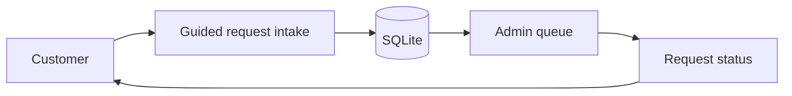
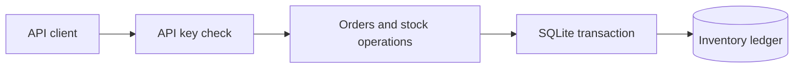

# Eyal Alizade — Programming & Automation

Practical software demos: a service bot, an inventory API, and tools that automate everyday work.

**Contact:** [mr.pitronot@gmail.com](mailto:mr.pitronot@gmail.com)

These are portfolio projects built with synthetic examples. They are not presented as past client engagements or as independently audited production services. Each project includes runnable code, an offline demo or sample workflow, tests, and documented limits.

## Featured projects

### [DeskBuddy — Telegram Service Bot](deskbuddy-telegram-bot/README.md)

A friendly service-request bot with a real workflow behind the conversation: guided intake, persistent requests, status updates, an admin queue, and access controls. An offline simulator lets you explore it without a Telegram token.



### [StockPilot — Inventory & Order API](stockpilot-api/README.md)

A business backend for products, stock movements, and orders. It demonstrates API authentication, transactional inventory changes, stock reservation, repeat-safe cancellation, and idempotent requests. Its offline demo exercises the API without deploying a server.



## More automation examples

| Project | What it demonstrates |
| --- | --- |
| [Batch File Organizer](batch-file-organizer/README.md) | Dry-run-first file organization, collision handling, and guarded undo |
| [CSV Report Builder](csv-report-builder/README.md) | Validated data processing, monetary calculations, and reproducible reports |
| [Backup Integrity Checker](backup-integrity-checker/README.md) | ZIP backups, streaming hashes, and integrity checks without extraction |

## Run the portfolio checks

Python 3.11 or newer is required. StockPilot uses FastAPI; the other projects use the Python standard library.

```sh
python -m venv .venv
# Linux / macOS:
source .venv/bin/activate
# Windows PowerShell instead:
# .venv\Scripts\Activate.ps1
python -m pip install -r stockpilot-api/requirements-dev.txt
python tools/check_portfolio.py
```

To test a single dependency-free project:

```sh
python tools/check_portfolio.py --project batch-file-organizer
```

Project READMEs provide the individual demo commands, configuration, and constraints. The GitHub Actions workflow is included for execution after publication; local verification is recorded separately in [verification.json](verification.json).

## אייל אליזאדה — תכנות ואוטומציה

אני בונה תוכנות, בוטים ואוטומציות בהתאם לצורך. כאן אפשר לראות פרויקטי הדגמה עם קוד, דוגמאות, בדיקות ותיעוד: בוט שירות, מערכת מלאי והזמנות וכלים לעיבוד נתונים וקבצים.

לבדיקת פתרון מותאם: **mr.pitronot@gmail.com**. כתבו בקצרה מה עושים היום ומה תרצו לקבל בסוף. היקף, מחיר ומועד מסירה מסוכמים אחרי בירור הצורך ובדיקת היתכנות.

הפרויקטים כאן הם הדגמות יכולת, עם נתונים לדוגמה. קוד שמיועד ללקוח מותאם לסביבת העבודה ולדרישות שלו לפני מסירה.
