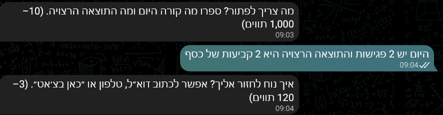
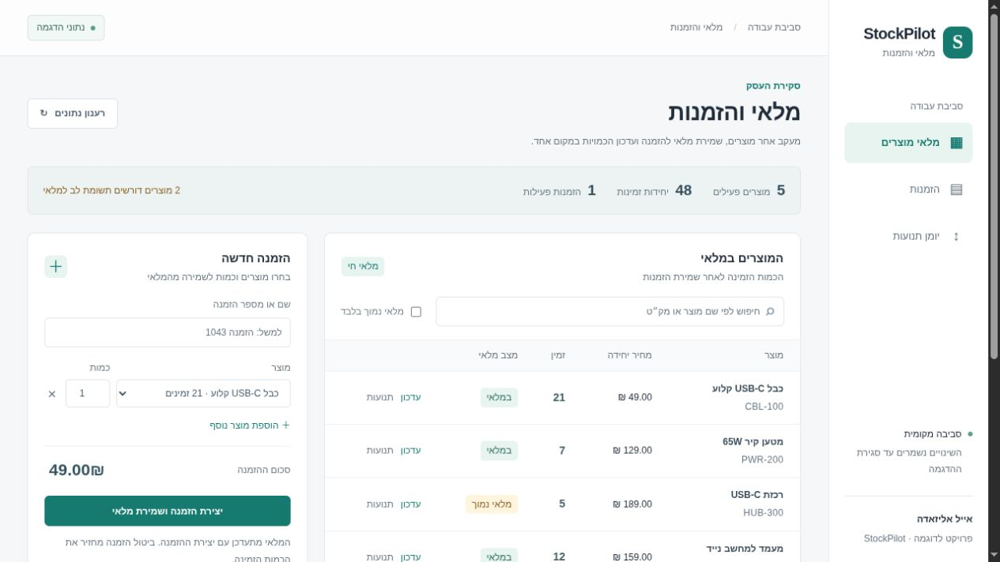
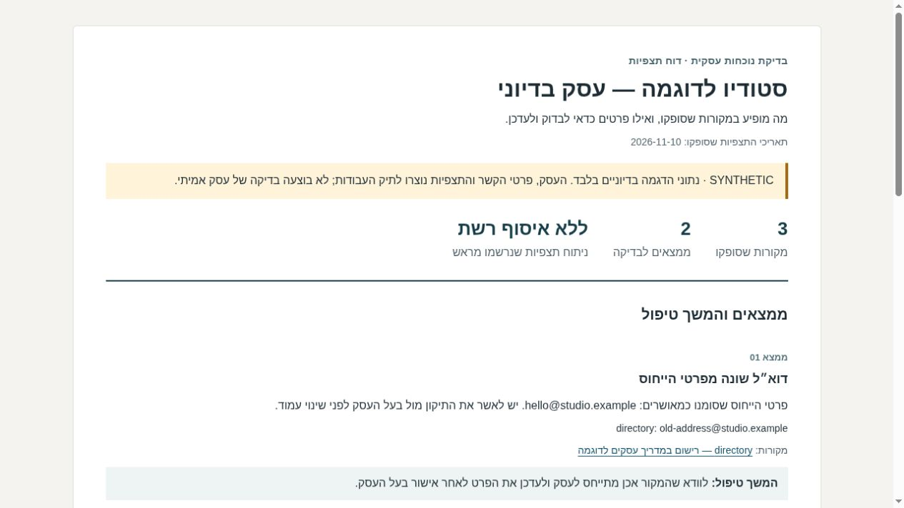

# אייל אליזאדה — תכנות ואוטומציה

יש לכם משימה שחוזרת על עצמה, או רעיון לכלי שאין לכם זמן לבנות?
אני בונה תוכנות, בוטים ואוטומציות שחוסכים את ההתעסקות הזאת.

אפשר לפנות גם בלי לדעת לתכנת או לעבוד עם כלי AI. מסבירים מה עושים היום ומה רוצים לקבל, ומשם בודקים מה כדאי לבנות.

**לפניות: [mr.pitronot@gmail.com](mailto:mr.pitronot@gmail.com)**

## בוט שמרכז פניות

לקוח כותב מה הוא צריך, הבוט שואל כמה שאלות ושומר את הבקשה. מי שמטפל בפניות מקבל תור מסודר ויכול לסגור בקשה ולעדכן את הלקוח.



זה חיתוך מצילום בדיקה אמיתי בתוך Telegram, בשלב מילוי הבקשה לפני שליחתה. בפרויקט יש גם סימולטור מקומי שמציג את המשך הטיפול והסגירה, וצילומיו מסומנים בנפרד.

[לפרויקט DeskBuddy ולהוראות ההרצה](deskbuddy-telegram-bot/README.md)

## מלאי והזמנות במקום עבודה ידנית

רואים כמה נשאר מכל מוצר, פותחים הזמנה ומעדכנים מלאי. אם אין מספיק יחידות, ההזמנה נעצרת. ביטול הזמנה מחזיר את הכמות למלאי.



המסך עובד מול ה־API ומסד הנתונים של הפרויקט. המוצרים וההזמנות בצילום הם נתוני דוגמה.

[לפרויקט StockPilot ולהוראות ההרצה](stockpilot-api/README.md)

## דוח על נוכחות העסק ברשת

מרכזים תצפיות ממקורות ציבוריים, משווים פרטי קשר לפרטים שבעל העסק אישר, ומפיקים דוח עם המקור לכל ממצא והמלצה לפעולה. מידע שלא תועד נשאר מסומן כלא ידוע.



צילום של דוח HTML שהכלי הפיק בפועל, עם עסק ומקורות מלאכותיים שמסומנים בדוח. הכלי עובד על תצפיות שהוזנו אליו; הוא אינו מחפש ברשת או מאמת בעצמו את תוכן המקורות.

[לפרויקט בדיקת הנוכחות העסקית ולהוראות ההרצה](business-footprint-review/README.md)

## עוד דוגמאות

| כלי | מה הוא עושה |
| --- | --- |
| [ארגון קבצים](batch-file-organizer/README.md) | ממיין קבצים לתיקיות, מציג מה ישתנה לפני הביצוע ומאפשר לבטל העברה שנעשתה |
| [דוחות מקובצי CSV](csv-report-builder/README.md) | מאחד קבצים, מסיר כפילויות זהות ומפיק סיכומים עם בדיקת נתונים |
| [גיבוי ובדיקת קבצים](backup-integrity-checker/README.md) | יוצר גיבוי ובודק אם קובץ חסר או השתנה, בלי לפתוח את הגיבוי לתיקייה |

אלה פרויקטי הדגמה שבניתי לתיק העבודות. הם מראים סוגי פתרונות שאפשר להתאים לבקשה מסוימת. בכל עבודה מסכמים מראש מה בונים, מחיר ומועד מסירה.

## למי שרוצה לעבור על הקוד

הקוד כתוב ב־Python. בכל תיקייה יש הוראות הרצה, דוגמאות ובדיקות. מסכי ההדגמה רצים מקומית; אין צורך בחשבון Telegram כדי לנסות את הבוט.

להרצת כל הבדיקות צריך Python 3.11 ומעלה וגם Node.js 20 ומעלה לבדיקות הממשק:

```sh
python -m venv .venv
source .venv/bin/activate
# ב־Windows PowerShell: .venv\Scripts\Activate.ps1
python -m pip install -r stockpilot-api/requirements-dev.txt
python tools/check_portfolio.py
```

אפשר להריץ גם בדיקות של פרויקט אחד:

```sh
python tools/check_portfolio.py --project batch-file-organizer
```

[תוצאות הבדיקה המקומית](verification.json) · [תיעוד צילומי ההדגמה](SCREENSHOTS.md)
