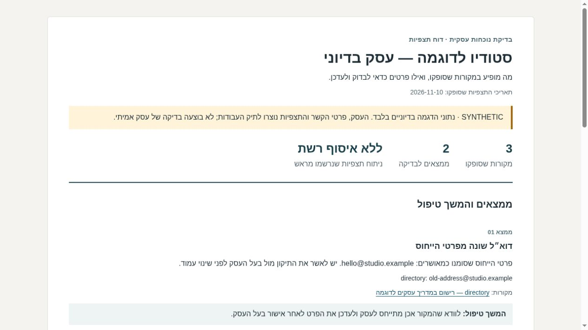
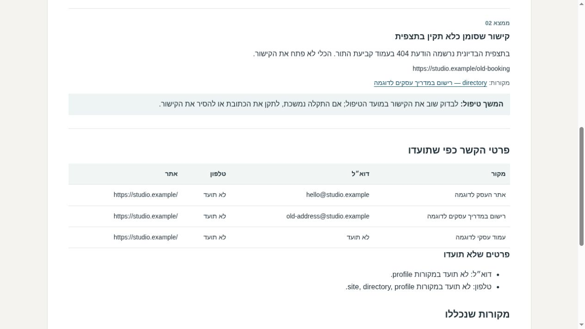

# מה רואים על העסק ברשת?

אוספים פרטים מכמה עמודים ציבוריים של עסק, ורוצים להבין מה דורש טיפול.
הכלי משווה את התצפיות לפרטי קשר שבעל העסק אישר, מצביע על הבדלים ומפיק
דוח קצר בעברית עם מקור, תאריך והצעת המשך לכל ממצא.

זה כלי עזר לעבודת OSINT על נוכחות עסקית. **את החיפוש, זיהוי העסק ואימות
התצפיות מבצעים לפני הזנת הקובץ.** התוכנה אינה גולשת או בודקת קישורים בעצמה.

## הדוגמה שבפרויקט

הדוגמה כוללת שלושה מקורות ושני ממצאים: כתובת דוא״ל שונה מפרטי הייחוס,
וקישור שסומן כלא תקין בתצפית. פרטי טלפון שלא תועדו מופיעים כ״לא ידוע״,
ולא כתקלה שהכלי המציא.

**SYNTHETIC — כל הנתונים בדיוניים.** שמות העסק, כתובות הדוגמה והתצפיות
נוצרו לתיק העבודות. הכתובות משתמשות בסיומת `.example`; לא בוצעה בדיקה
של עסק אמיתי ולא מדובר בעבודה ללקוח.

[דוח Markdown שנוצר בהרצה](examples/report/report.md) ·
[דוח HTML עצמאי להורדה ופתיחה בדפדפן](examples/report/report.html) ·
[קובץ התצפיות לדוגמה](footprint_review/demo.json)



צילום של דוח ה־HTML שנפתח בדפדפן מקומי. הכיתוב SYNTHETIC והמקורות
הבדיוניים הם חלק מהדוח עצמו. אין כאן תוצאות מחקר על עסק אמיתי.



## הפעלה

צריך Python 3.11 ומעלה, ללא ספריות נוספות. מתוך תיקיית הפרויקט:

```sh
python -m footprint_review demo --output demo-output
```

ב־Windows אפשר להשתמש ב־Python Launcher:

```powershell
py -3 -m footprint_review demo --output demo-output
Start-Process .\demo-output\report.html
```

ב־Linux פותחים את `demo-output/report.html` בדפדפן או קוראים את `report.md`.
אין שרת, התקנה, מפתח API או חיבור לרשת. הדוח מכיל קישורי מקורות; לחיצה עליהם
פותחת את הכתובת בדפדפן. קישורי הדוגמה אינם עמודים אמיתיים.

```text
Reviewed 3 supplied sources; 2 findings for review.
Reports: demo-output
No network requests were made. Open report.html or report.md.
```

להפקת דוח מתצפיות שאספתם בהסכמה:

```sh
python -m footprint_review report observations.json --output review-output
```

תיקיית התוצאה חייבת להיות חדשה. גם תיקייה ריקה קיימת לא תידרס.
אם יש תקלה בכתיבה לאחר יצירת התיקייה, היא עשויה להכיל דוח חלקי; בודקים את
הודעת השגיאה ומריצים מחדש לתיקייה חדשה. קובץ הקלט אינו משתנה.

| קובץ תוצאה | מה יש בו |
| --- | --- |
| `report.html` | דוח בעברית, לקריאה בדפדפן, ללא ספריות או משאבים חיצוניים |
| `report.md` | ממצאים, מקורות ותאריכי תצפית בפורמט טקסט |
| `observations.json` | עותק מנורמל של הקלט, כדי שאפשר יהיה לשחזר את ההשוואה |

## איזה מידע מזינים?

מעתיקים את [קובץ הדוגמה](footprint_review/demo.json) לקובץ חדש ומחליפים רק
בתצפיות מתועדות על עסק שמותר לכם לבדוק. בקלט אמיתי קובעים
`data_kind` ל־`public_observations`; בדוגמה משאירים `synthetic`.

- `business.name`: שם העסק שנבדק.
- `business.owner_confirmed_reference`: מצהירים `true` רק לאחר שבעל העסק אישר את פרטי הייחוס. זה סימון של עורך הדוח, לא אימות שהתוכנה מבצעת.
- `business.contacts`: כתובת דוא״ל, טלפון ואתר מאושרים, או `null` לפרט שאינו ידוע.
- `sources`: עד 50 תצפיות, כל אחת עם מזהה ייחודי, שם, כתובת מקור ותאריך `YYYY-MM-DD`.
- בכל מקור מתעדים `contacts` ומערך `links`. כל קישור כולל כתובת, הערה ומצב שתועד: `working`, `broken` או `not_checked`.

אין צורך למלא שדה שלא נצפה: אפשר להשמיט אותו מתוך `contacts` או לסמן
`null`. מחרוזת ריקה נדחית כדי שלא תתפרש בטעות כעובדה. לא מכניסים סיסמאות,
מידע מחשבונות פרטיים או פרטים אישיים שאינם נחוצים לדוח העסקי.

## איך נקבע ממצא?

פרט שנצפה מושווה לפרט הייחוס שהוזן. הבדל מוצג לבדיקה ואינו קביעה שהעמוד
שגוי או שייך לעסק הנכון. בלי פרט ייחוס, ערכים סותרים בין מקורות מוצגים
כסתירה שצריך לברר; הכלי אינו בוחר איזה מקור צודק.

מספרי טלפון מושווים לפי ספרות בלבד, ללא ניחוש קידומת מדינה. כתובות דוא״ל
מושוות ללא הבדל בין אותיות גדולות וקטנות; זו השוואה לצורך סקירה, לא בדיקת
בעלות או יכולת קבלת דואר. בכתובות אתר מתעלמים מאותיות גדולות במארח,
מלוכסן סופי וממקטע `#fragment`; מסלול ופרמטרי חיפוש נשארים משמעותיים.

ממצא על קישור מופק רק אם מישהו סימן אותו `broken` בקלט. אין בקשת רשת,
אימות HTTP או הבטחה שהתקלה עדיין קיימת. ערך חסר אינו הוכחה שלא מופיע מידע
ברשת. דוח בלי ממצאים אינו אישור שהעסק תקין, מאובטח או נקי ממידע נוסף.

## למי שרוצה לעבור על הקוד

| קובץ | אחריות |
| --- | --- |
| `schema.py` | טעינת JSON, גבולות גודל ואימות שדות וכתובות |
| `analysis.py` | השוואת התצפיות ויצירת ממצאים עם הפניה למקורות |
| `reporting.py` | הפקת Markdown ו־HTML וכתיבה לתיקייה חדשה |
| `styles.css` | עיצוב הדוח, כולל מסך צר והדפסה |
| `__main__.py` | פקודות הדוגמה והפקת הדוח |

HTML escapes supplied text and attributes and has a restrictive Content Security
Policy. URLs must be public-shaped HTTP(S) addresses without embedded credentials,
local/private IPs or nonstandard ports. This syntax check does not resolve DNS,
establish public accessibility or validate authorization. No URL is fetched.
JSON is bounded to 2 MB; duplicate keys, source IDs and unsupported fields fail
before output creation. Reports use UTF-8 and retain their supplied observation dates.

```sh
python -m unittest discover -s tests -v
```

הבדיקות מכסות שגיאות קלט, סתירות, מידע לא ידוע, ניקוי תצוגת תוכן, קישורים
לא מתאימים, שחזור קלט ושמירה על קבצים קיימים. הרצה מקומית אינה בדיקה מול
שירות חי או בדיקת Windows בפועל.

אייל אליזאדה / Eyal Alizade · [mr.pitronot@gmail.com](mailto:mr.pitronot@gmail.com)
