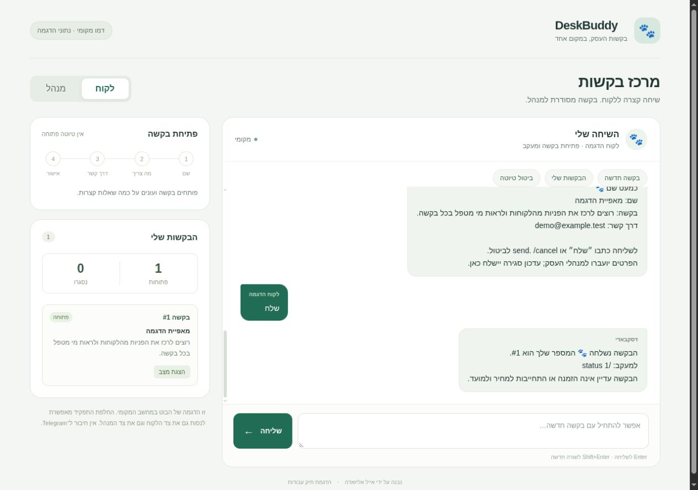
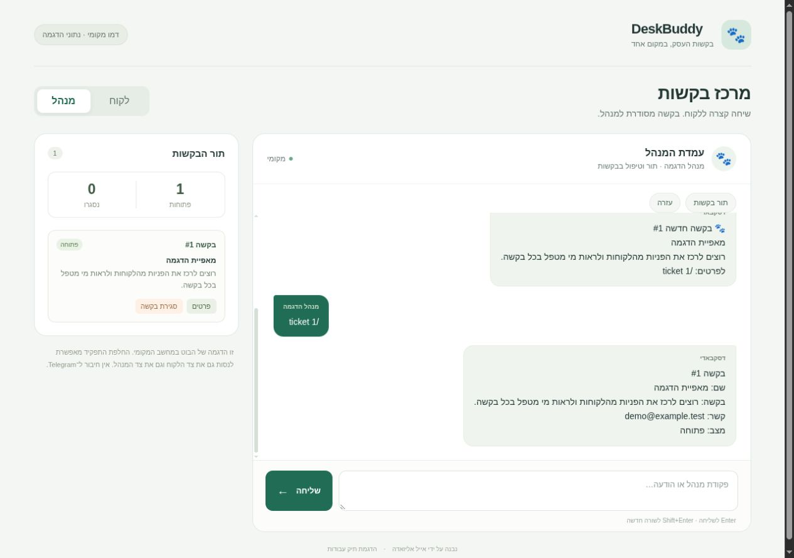

# דסקבאדי 🐾

בוט לאיסוף בקשות לעסק. הלקוח עונה על כמה שאלות, מאשר את הפרטים ומקבל מספר בקשה. המנהל רואה תור מסודר ויכול לסגור את הטיפול.

זה פרויקט לתיק העבודות שלי. הדוגמאות והמשתמשים שמופיעים בו מלאכותיים.

## כך זה נראה

צילומי מסך מהרצה מקומית של הבוט, עם נתוני הדגמה. מסך הדפדפן מפעיל את קוד השיחה והאחסון של הבוט; התמונות אינן מתוך Telegram.

**צד הלקוח:** בקשה שנשלחה ומספר למעקב.



**צד המנהל:** אותה בקשה בתור, כולל פרטים ודרך קשר.



## לנסות בדפדפן

צריך Python 3.11 ומעלה. אין ספריות להתקין. מתוך תיקיית הפרויקט:

```bash
python -m deskbuddy web-demo --port 8812
```

פותחים את [ההדגמה המקומית](http://127.0.0.1:8812).

1. במצב **לקוח**, לוחצים על **בקשה חדשה** ועונים על השאלות.
2. בודקים את הפרטים ולוחצים על **אישור ושליחת הבקשה**.
3. עוברים ל־**מנהל** כדי לראות את התור, לפתוח פרטים ולסגור בקשה.
4. חוזרים לצד הלקוח כדי לראות את עדכון הסגירה.

הממשק מפעיל את אותו קוד שמטפל בהודעות הבוט, עם SQLite ותחליף מקומי ל־Telegram. רענון הדף שומר את השיחה כל עוד התהליך פועל. עצירת השרת מוחקת את נתוני ההדגמה הזמניים.

אין צורך בחשבון Telegram או בטוקן. שרת ההדגמה מאזין רק ל־127.0.0.1. החלפת התפקידים מיועדת לניסוי מקומי; אין לחשוף את הדמו לאינטרנט.

## הדגמה במסוף

```bash
python -m deskbuddy demo
python -m deskbuddy demo --json
python -m deskbuddy simulate
```

ב־simulate אפשר להחליף בין לקוח למנהל באמצעות `:as 1001` ו־`:as 9001`. `:quit` מסיים. לשמירה בין הפעלות מוסיפים `--db .deskbuddy/offline.sqlite3`.

[תמליל הדגמה מלא](examples/demo-transcript.txt) מציג גם הפעלה מחדש באמצע שיחה ועדכון כפול שמטופל פעם אחת.

## פקודות הבוט

| לקוח | מנהל |
| --- | --- |
| `/new` לפתיחת בקשה | `/queue [page]` לתור בקשות פתוחות |
| `/status [id]` למצב הבקשות שלו | `/ticket id` לפרטי בקשה |
| `/cancel` לביטול טיוטה | `/close id [note]` לסגירה ולעדכון הלקוח |
| `/start`, `/help` להכוונה | הרשאה לפי מספרי המשתמשים שהוגדרו |

אישור הבקשה אינו הזמנה מסחרית או התחייבות למחיר ולמועד.

## מבנה הקוד

```text
deskbuddy/
  service.py     שלבי השיחה ובדיקת הרשאות
  messages.py    נוסחי השאלות והתשובות
  db.py          טיוטות, בקשות ותור הודעות ב־SQLite
  runner.py      קבלת עדכונים ושליחת תשובות
  transport.py   חיבור Telegram והתחליף המקומי
  web_demo.py    שרת ההדגמה המקומית
  web/           HTML, CSS ו־JavaScript של הממשק
```

שינוי הבקשה, סימון העדכון ותור התשובות נשמרים באותה עסקת SQLite. עדכון שכבר עובד לא יוצר בקשה נוספת. תשובות שממתינות לשליחה נשמרות להפעלה הבאה.

## חיבור לבוט Telegram משלך

בהפעלת הבוט נרשם תפריט פקודות בתוך Telegram, עם תיאורים בעברית. לקוח רואה פתיחת בקשה, מעקב, ביטול טיוטה ועזרה. בשיחה הפרטית של כל מנהל נוסף גם תור בקשות, הצגת פרטים וסגירה.

בחירה ב־`/ticket` או ב־`/close` מציגה הוראות להוספת מספר בקשה; למשל `/ticket 1`. אם רישום התפריט נכשל, מופיעה אזהרה והבוט ממשיך לעבוד עם פקודות כתובות. הפעלה מחדש מנסה לרשום את התפריט שוב.

מצב `poll` הוא היחיד שפונה ל־Telegram. מגדירים בסביבת ההרצה:

| משתנה | תוכן |
| --- | --- |
| `TELEGRAM_BOT_TOKEN` | הטוקן של הבוט |
| `DESKBUDDY_ADMIN_IDS` | מספרי המשתמש של המנהלים, מופרדים בפסיק |

```bash
python -m deskbuddy poll --db .deskbuddy/live.sqlite3
```

קובץ `.env.example` מציג את שמות המשתנים; התוכנית אינה קוראת קובצי `.env` בעצמה. אין להכניס טוקן לקוד או למאגר.

מריצים תהליך polling אחד לכל בוט. webhook פעיל מונע polling; התוכנית לא מסירה אותו אוטומטית. מנהלים צריכים לפתוח שיחה עם הבוט כדי לקבל הודעות פרטיות. נתוני הסימולטור לא יכולים להישלח דרך מצב Telegram, ומסד חי נקשר לבוט אחד.

## בדיקות וגבולות

```bash
python -m unittest discover -s tests -v
```

הבדיקות האוטומטיות מכסות הרשאות, בעלות על בקשות, ביטול טיוטה, הפעלה מחדש, עדכונים כפולים, כשל בשמירה, הגבלת קצב, תור תשובות, רישום תפריט הפקודות ונתיבי ההדגמה המקומית. הן פועלות מול תחליף ל־Telegram, ללא רשת.

ב־4 בנובמבר 2026 בוצעה גם בדיקה ידנית עם בוט Telegram אמיתי שהופעל ב־Windows. בצילומים שסופקו נראו אישור הגדרת מנהל ואיסוף פרטי בקשה עד הסיכום שלפני השליחה. יצירת בקשה, הצגתה בתור, סגירתה ותצוגת תפריט הפקודות עדיין ממתינות לאישור בבדיקה החיה. צילומי ההדגמה למעלה הם מהסימולטור המקומי.

- עד 12 הודעות למשתמש בדקה ועד שלוש בקשות פתוחות.
- שם: 2–80 תווים. בקשה: 10–1,000. דרך קשר: 3–120. הודעה נכנסת: עד 2,000.
- שרת הדמו מקבל JSON מוגבל בגודל מאותו מקור בלבד. הוא מגיש רק את שלושת קובצי הממשק המוגדרים.
- פרטי הקשר נשמרים ב־SQLite ללא הצפנה ברמת היישום. לפני שימוש שוטף צריך לקבוע דרך גיבוי, מחיקה ושמירת מידע.
- אם Telegram קיבל הודעה והתהליך נעצר לפני שסומן שהיא נשלחה, אותה תשובה עשויה להישלח שוב. בקשה עסקית לא נוצרת שוב מאותו עדכון.
- הודעה שנדחתה לצמיתות מסומנת `failed` בתור השליחה ומצריכה בדיקה ידנית.

פרטי החיבור ותפריט הפקודות מבוססים על [התיעוד הרשמי של Telegram](https://core.telegram.org/bots/api), שנבדק ב־4 בנובמבר 2026.

## English

DeskBuddy collects business requests through a short Hebrew conversation. Try the local browser demo with `python -m deskbuddy web-demo --port 8812`, then switch between the synthetic customer and admin roles. It runs the actual bot service and SQLite storage with no Telegram credentials or external requests.

**אייל אליזאדה / Eyal Alizade** · **mr.pitronot@gmail.com**
