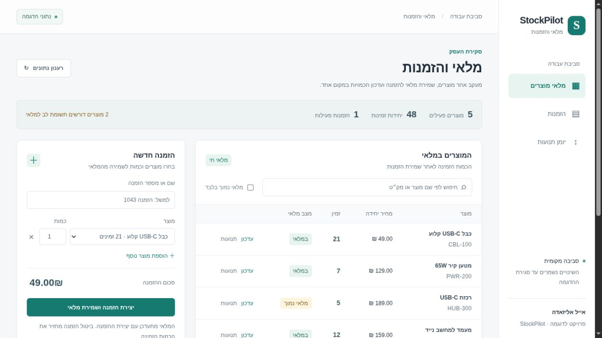
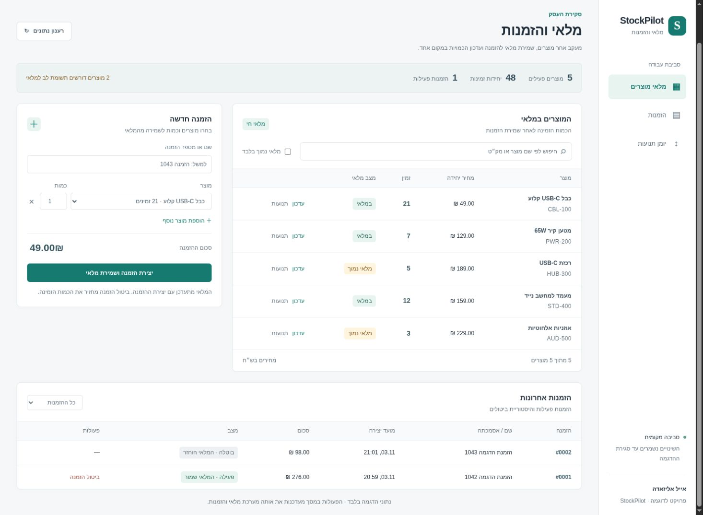

# StockPilot — מלאי והזמנות

מסך עבודה בעברית לניהול מוצרים, עדכון כמויות ופתיחת הזמנות. יצירת הזמנה שומרת את הפריטים מהמלאי; ביטול מחזיר אותם. יומן תנועות מציג כל שינוי.



צילום מהרצה מקומית עם נתוני הדגמה. הפעולות במסך נשלחות ל־API ונשמרות ב־SQLite.

בתמונה הבאה, הזמנה נוספת נוצרה ואז בוטלה. הכמות חזרה למלאי, וההזמנה נשארה בהיסטוריה עם מצב **בוטלה**.



## הפעלה מקומית

דרוש Python 3.11 ומעלה. מתוך תיקיית הפרויקט:

```sh
python -m venv .venv
.venv/bin/python -m pip install -r requirements.txt
.venv/bin/python demo_server.py --port 8811
```

פותחים את [מסך ההדגמה](http://127.0.0.1:8811). אין צורך להגדיר מפתח או חשבון. ב־Windows מחליפים את `.venv/bin/python` ב־`.venv\Scripts\python.exe`.

ההדגמה נפתחת עם חמישה מוצרים והזמנה פעילה. היא משתמשת במסד נתונים זמני חדש בכל הפעלה, ללא קשר למסד נתונים או למפתחות שהוגדרו עבור יישום אחר. הנתונים נמחקים כשהשרת נסגר. `Ctrl+C` סוגר את השרת.

## מה אפשר לנסות

1. לחפש מוצר ולראות את הכמות הזמינה ואת מצב המלאי.
2. ליצור הזמנה עם מוצר אחד או יותר ולראות שהכמות הזמינה יורדת.
3. לנסות להזמין מעבר לכמות הזמינה ולקבל הודעת שגיאה ברורה, ללא שינוי חלקי במלאי.
4. לבטל הזמנה ולראות שהכמות חוזרת למלאי; לפתוח את יומן התנועות כדי לבדוק את השינוי.

כפתור **עדכון** מאפשר להוסיף או להפחית יחידות ולציין את הסיבה. כל הפעולות במסך משתמשות באותו API ובאותם כללי מלאי. זהו פרויקט תיק עבודות אישי עם נתונים סינתטיים.

## בדיקות והדגמה ללא דפדפן

```sh
.venv/bin/python -m pip install -r requirements-dev.txt
.venv/bin/python -m unittest discover -s tests -v
.venv/bin/python demo.py --output-dir demo-output
```

`demo.py` יוצר דוח בדיקות, CSV סינתטי ומפרט OpenAPI. תיקיית הפלט חייבת להיות חדשה. פרטי ההרצה שנבדקה נמצאים ב־[VALIDATION.md](VALIDATION.md).

בדיקות התנהגות המסך משתמשות ב־Node.js ובכלים המובנים שלו, ללא חבילות נוספות:

```sh
node tests/test_ui_workflows.mjs
```

## Developers

FastAPI + Pydantic + SQLite, with vanilla HTML/CSS/JavaScript for the local demo. No frontend build step or external services. The public Python entry point remains `from stockpilot import create_app`.

The implementation is split by responsibility:

- `stockpilot_core/app.py` — application configuration and error handling.
- `stockpilot_core/routes.py` — authentication, request validation and transaction boundaries.
- `stockpilot_core/inventory.py` and `orders.py` — product, stock and order operations.
- `stockpilot_core/database.py`, `schemas.py` and `responses.py` — persistence, models, idempotency and CSV responses.
- `ui/` — Hebrew screen with separate HTML, CSS and readable JavaScript functions.
- `demo_server.py` — isolated synthetic demo, served only on loopback.

### Run the API with your own local configuration

```sh
export STOCKPILOT_API_KEY="$(.venv/bin/python -c 'import secrets; print(secrets.token_urlsafe(32))')"
export STOCKPILOT_DB="data/stockpilot.sqlite3"
.venv/bin/python -m uvicorn stockpilot:create_app --factory --host 127.0.0.1 --port 8000
```

The production factory requires a random 24–200 character URL-safe key and has no demo-session endpoint. Business endpoints require `X-API-Key`. Local documentation: [Swagger](http://127.0.0.1:8000/docs), [ReDoc](http://127.0.0.1:8000/redoc), [OpenAPI JSON](http://127.0.0.1:8000/openapi.json). Swagger/ReDoc use their usual CDN assets; the API and exported schema do not require those assets.

All business routes begin with `/api/v1`:

| Method and path | Operation |
|---|---|
| `POST /products` | Create a product and optional opening stock |
| `GET /products` | List/filter products: `active`, `q`, `low_stock`, `limit`, `offset` |
| `GET /products/{id}` | Read a product |
| `PATCH /products/{id}` | Update name, price or active flag |
| `DELETE /products/{id}` | Archive a product and preserve history |
| `POST /products/{id}/adjustments` | Adjust stock with a reason and `Idempotency-Key` |
| `GET /products/{id}/ledger` | List movements |
| `POST /orders` | Atomically reserve order lines with `Idempotency-Key` |
| `GET /orders` | List/filter orders by status and customer reference |
| `GET /orders/{id}` | Read order and price/name snapshots |
| `POST /orders/{id}/cancel` | Cancel and restore stock once |
| `GET /exports/products.csv` or `/exports/orders.csv` | Spreadsheet-safe export |

### Data and retry rules

- Money uses integer cents. Quantities are whole units. `available` means stock available for a new reservation. Product/order IDs must be positive and at most `2^63 - 1`.
- Writes use `BEGIN IMMEDIATE`, conditional stock updates and enabled foreign keys. A failed line rolls back the complete order, stock changes, ledger and idempotency record.
- Order creation and stock adjustments require a key of 8–128 URL-safe characters. A retry with the same normalized body returns the original response; another body returns `409`. Key scope is order creation or the individual product's adjustments. Failed requests are not cached; records do not expire automatically.
- Retrying creation after cancellation returns the original reservation response without reserving again. Use `GET /orders/{id}` for current status. Repeated cancellation never restores stock twice.
- Prices, names and SKUs are stored on order lines. Product edits preserve those snapshots. Archived products cannot be reserved. Cancellation that would exceed the stock maximum fails and rolls back.
- Validation errors return `422`, invalid keys `401`, missing records `404`, conflicts/stock shortages `409`, and busy databases `503`. Retry a failed or uncertain mutation using its original idempotency key and body.
- Lists default to 50 rows, maximum 100. CSV export rejects more than 10,000 rows. CSV quoting, a UTF-8 BOM and apostrophe prefixes for spreadsheet formula markers are applied.

The demo launcher always generates a new key for its own fresh database and ignores `STOCKPILOT_API_KEY` / `STOCKPILOT_DB`. Its session endpoint exists only in the demo application. It accepts localhost hostnames and binds to `127.0.0.1`; it is not a deployment command.

This is a single-tenant local backend. It does not include payments, fulfillment, per-user roles, TLS termination, rate limiting, multiple warehouses or migration tooling. SQLite serializes writers. Database files, virtual environments and generated output are ignored by Git. Exact tested dependencies are recorded in `requirements-lock.txt`.

References: [FastAPI testing](https://fastapi.tiangolo.com/tutorial/testing/), [API-key security](https://fastapi.tiangolo.com/reference/security/).

אייל אליזאדה / Eyal Alizade · [mr.pitronot@gmail.com](mailto:mr.pitronot@gmail.com)

No license grant has been selected.
